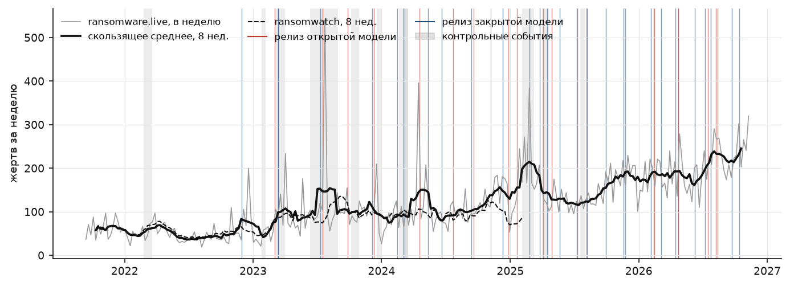
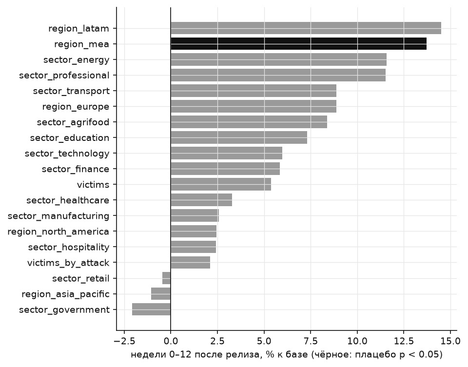
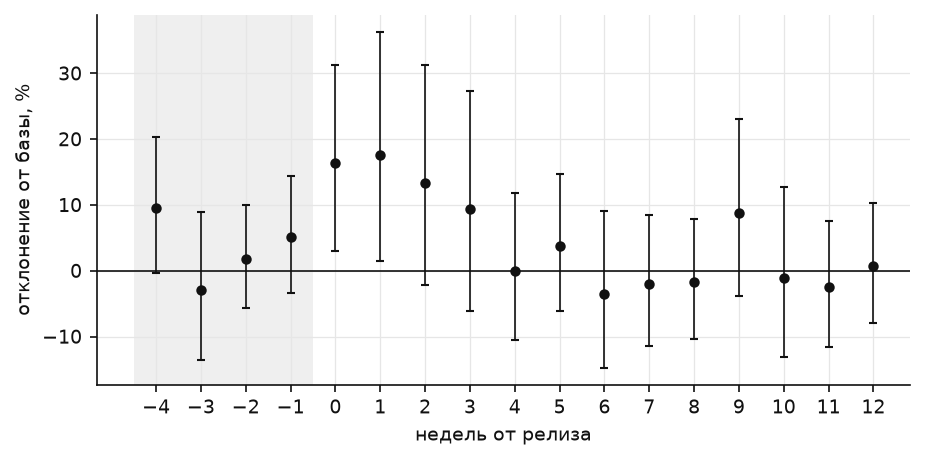
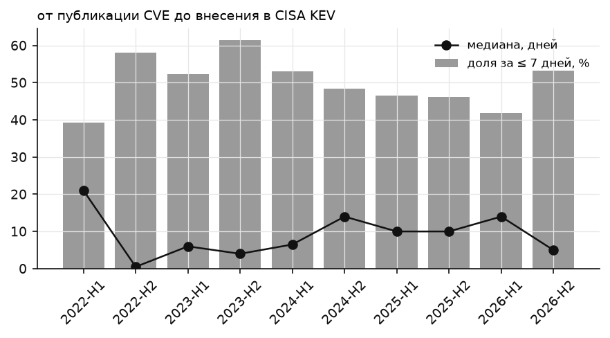
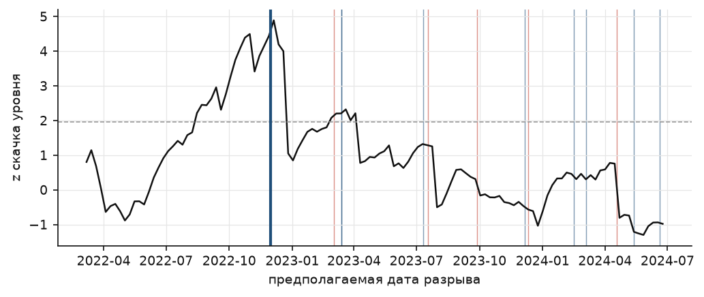
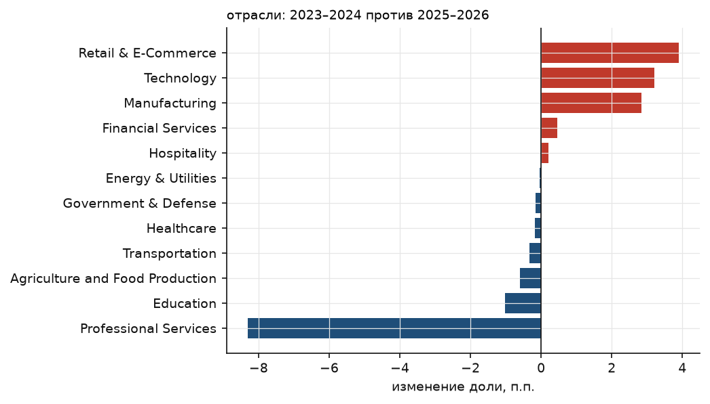

# Око Перуна

Проверяем, становится ли больше кибератак после выхода новых LLM и меняется ли их состав. Берём открытые данные с сентября 2021 по ноябрь 2026 года и смотрим по неделям, что происходит вокруг каждого релиза.

Команда: Чернов Степан, Левковская Эмилия, Сергеев Артём, Малинин Дмитрий.

## Коротко

Связи между выходом крупной модели и ростом атак в ближайшие недели мы не нашли. Три недели после релиза группы шифровальщиков выкладывают больше жертв, но по дате самой атаки роста нет. В конце 2022 года атак стало больше, однако тогда же рос весь рынок шифровальщиков, и по нашим данным одно от другого не отделить.

Всего в данных 270 недель с 13.09.2021 по 09.11.2026. За это время группы выложили 31 994 жертвы и вышло 48 крупных моделей: 19 с открытыми весами и 29 только через API. Ещё взяли 900 CVE из KEV с известной датой публикации.

Все проценты ниже показывают, насколько неделя отличается от того, что ждёт модель. Модель при этом учитывает общий тренд, сезонность, рождественскую неделю и 12 посторонних событий вроде волны MOVEit.



## Результаты

### H1. После крупных релизов атак становится больше

За 13 недель после релиза жертв в среднем на 5,4 % больше ожидаемого. Чтобы проверить, не случайность ли это, мы 500 раз сдвигали все даты релизов в случайное место. Такой же или больший рост получался примерно в каждом пятом случае (p = 0,20).

Отдельно посчитали 19 рядов: весь мир, пять регионов, двенадцать отраслей и ряд по дате атаки. При стольких проверках часть «эффектов» неизбежно найдётся случайно, поэтому делали поправку Бенджамини–Хохберга. После неё значимых рядов нет, минимальное q = 0,47.



H1 не подтвердилась.

### H2. Эффект приходит с задержкой



| Недели после релиза | Выложенные жертвы | p (плацебо) | По дате атаки, 2023+ | p (плацебо) |
|---|---|---|---|---|
| за 4…1 до | +2,1 % | 0,65 | −0,1 % | 0,99 |
| 0…3 | **+13,1 %** | **0,04** | +1,7 % | 0,72 |
| 4…7 | −1,1 % | — | −0,3 % | 0,97 |
| 8…12 | +1,5 % | — | −0,2 % | 0,97 |

В первые три недели после релиза группы выкладывают на 13 % больше жертв. Но жертву обычно выкладывают через несколько дней после атаки (медиана от 1 до 7 дней в разные годы), а четверть — через две недели и позже. Значит, большинство этих атак случилось ещё до релиза.

Если считать по дате атаки за те же годы, роста нет: +1,7 %, p = 0,72. Роста через 4–12 недель, которого ждала H2, тоже нет.

В прошлом проекте мы ошиблись так же: сигнал из даркнета появлялся уже после атаки. Скорее всего, релизы и пачки постов просто чаще приходятся на одни и те же недели. Например, в конце февраля и в марте много и релизов, и волн Cl0p. В спринте 4 проверим это по отдельным группам.

H2 не подтвердилась.

### H3. Открытые модели влияют сильнее закрытых

| Релизы | Сколько | Недели 0…12 | p (плацебо) |
|---|---|---|---|
| Открытые веса | 19 | −0,3 % | 0,96 |
| Только API | 29 | +12,5 % | 0,07 |

После закрытых моделей рост даже больше, чем после открытых. Тест Вальда считает разницу значимой (p = 0,04), плацебо — нет. С обычными стандартными ошибками для закрытых моделей вышло бы p = 0,005, и без плацебо мы приняли бы это за результат.

Число всех языковых моделей, вышедших за неделю (по реестру Epoch), тоже ни на что не влияет:
- −5,0 % на каждый открытый релиз (95 % ДИ от −9,9 до +0,2);
- −10,6 % на каждый закрытый (95 % ДИ от −20,7 до +0,9).

H3 не подтвердилась.

### H4. С ИИ растёт доля технически сложных атак



- После релизов в KEV попадает на 11,7 % больше новых CVE (p = 0,08), а CVE, которые использовали шифровальщики, на 28,4 % больше (p = 0,08). Это на грани значимости. Проверим по дате начала эксплуатации, а не по дате, когда CISA внесла CVE в каталог.
- Быстрее эксплуатировать уязвимости не стали. До ChatGPT от публикации CVE до попадания в KEV в медиане проходило 7 дней, после — 8 (p = 0,002). В 2025–2026 годах 9 дней против 6 в 2022–2024 (p = 0,007). За неделю или быстрее в каталог попадало 52–61 % CVE в 2023 году и 42–53 % в 2026-м. Правда, все эти цифры зависят ещё и от того, как быстро работает сама CISA.
- После появления WormGPT, FraudGPT, PromptLock, HexStrike и ИИ-агентов ни один ряд не изменился, p везде не меньше 0,47.
- В Exploit-DB после релизов на 39 % больше эксплойтов, но p = 0,21. Эксплойты там выходят пачками, выводов по этому ряду не делаем.

H4 не подтвердилась. Ряд KEV ещё перепроверим в спринте 4.

### H0. Всплески объясняются другими событиями

| Событие | Изменение | p |
|---|---|---|
| Cl0p, волна Cleo (2025) | +60 % | < 0,001 |
| Cl0p, волна MOVEit (2023) | +52 % | 0,06 |
| Ликвидация Hive | −42 % | 0,006 |
| Война в Израиле | −26 % | < 0,001 |
| Выборы в США, 2024 | −21 % | < 0,001 |
| RansomHub уходит офлайн | −12 % | 0,09 |

С этими событиями девианс модели падает с 4343 до 3925, на 10 %. Два самых больших всплеска за пять лет дали массовые взломы Cl0p через уязвимости в MOVEit и Cleo. Рождественская неделя заметно не отличается от обычных.

H0 подтвердилась.

### Рост в конце 2022 года

Здесь сравниваем уровень и тренд до даты и после неё.

| Дата | Источник | Скачок | p | С учётом числа активных групп | p |
|---|---|---|---|---|---|
| ChatGPT, 30.11.2022 | ransomware.live | +64 % | < 0,001 | +22 % | 0,10 |
| ChatGPT | ransomwatch | +58 % | < 0,001 | +43 % | < 0,001 |
| Утечка LLaMA, 03.03.2023 | ransomware.live | +47 % | 0,04 | +1 % | 0,97 |
| DeepSeek-R1, 20.01.2025 | ransomware.live | −7 % | 0,51 | +14 % | 0,09 |



Скачок после выхода ChatGPT виден и в ransomware.live, и в ransomwatch. Но если прогнать тот же расчёт для каждой недели с марта 2022 по июнь 2024 года, дата ChatGPT окажется только третьей из 121, похожий скачок дают и соседние месяцы. В это время распалась Conti, выросли LockBit 3.0 и Cl0p. Связывать рост именно с ChatGPT поэтому нельзя.

Алгоритм PELT нашёл в ряду 7 переломов, 6 из них в пределах четырёх недель от какого-нибудь релиза. Но такие окна вокруг релизов покрывают 71 % всех недель, и совпадения ожидаемы.

### Как менялась структура атак



Доли отраслей и регионов за разные периоды заметно сдвигались, но не в даты релизов.

| Что сравнивали | Выросли | Упали |
|---|---|---|
| Отрасли до и после ChatGPT (хи-квадрат, p < 0,001) | технологии +2,6 п.п., профессиональные услуги +2,5 п.п., здравоохранение +2,2 п.п. | производство −3,6 п.п., ретейл −2,9 п.п. |
| Отрасли, 2025–2026 против 2023–2024 | ретейл +3,9 п.п., технологии +3,2 п.п., производство +2,8 п.п. | профессиональные услуги −8,3 п.п. |
| Регионы, 2025–2026 против 2024 | Азия и Океания +2,4 п.п., Европа +1,7 п.п., Латинская Америка +1,3 п.п. | Северная Америка −4,8 п.п. |

### Что это значит для ИБ-отделов

1. Усиливать мониторинг к выходу новых моделей не нужно, в ближайшие месяцы после релиза атак больше не становится.
2. Следить стоит за массовыми взломами файлообменников вроде MOVEit, Cleo и GoAnywhere. После них жертв за неделю становится на 50–60 % больше.
3. Группы выкладывают жертв с опозданием на дни и недели, поэтому для быстрого реагирования эти данные не годятся.

### Ограничения

- Группы выкладывают только тех, кто не заплатил выкуп.
- ransomware.live со временем следит за всё большим числом групп. Это мы учитываем через тренд и число активных групп.
- Для записей 2021–2022 годов страна почти никогда не указана, поэтому регионы считаем только с 2024 года.
- Если LLM влияют на атаки медленно, за годы, анализ по неделям это не поймает. Остаётся сравнение уровней до и после, а оно не доказывает, что причина именно в модели.
- С 2025 года крупные модели выходят почти каждую неделю, и недель без релиза поблизости для сравнения почти не осталось.

## Данные

| Источник | Что берём | Ряды в датасете |
|---|---|---|
| [ransomware.live](https://www.ransomware.live), API v2 | жертвы, которых группы выложили на свои сайты утечек: дата публикации, дата атаки, страна, отрасль, группа | `victims`, `victims_by_attack`, `region_*`, `sector_*` |
| [ransomwatch](https://github.com/joshhighet/ransomwatch) | те же сайты, другой сборщик (данные до весны 2025 года) | `ransomwatch` |
| [CISA KEV](https://www.cisa.gov/known-exploited-vulnerabilities-catalog) и [cvelistV5](https://github.com/CVEProject/cvelistV5) | уязвимости, которые эксплуатируют, и даты их публикации | `kev_fresh`, `kev_ransomware` |
| [Exploit-DB](https://gitlab.com/exploit-database/exploitdb) | публичные эксплойты, кроме модулей Metasploit | `exploits`, `exploits_cve` |
| [Epoch AI](https://epoch.ai/data) | все языковые модели и то, открыты ли у них веса | `llm_releases_open`, `llm_releases_closed` |
| `data/events/` | 48 крупных релизов, 16 событий с ИИ-инструментами для атак и 12 посторонних событий, которые могли дать всплески | `flagship_open`, `flagship_closed` |

Готовый датасет по неделям лежит в `data/processed/weekly.csv`. Сырые выгрузки в репозиторий не кладём: списков жертв не публикуем, только суммы по неделям.

## Как считаем

Число жертв за неделю моделируем пуассоновской регрессией. В модель входят:
- общий тренд (сплайн, примерно один изгиб на полгода);
- сезонность;
- рождественская неделя;
- посторонние события из `confounders.csv`.

Стандартные ошибки берём с поправкой на автокорреляцию (Newey–West, 4 лага).

Значимость везде проверяем плацебо: 500 раз сдвигаем все даты релизов в случайное место, сохраняя промежутки между ними. Для H2 смотрим недели с 4-й до релиза по 12-ю после. Рост после конкретной даты считаем как сравнение уровня и тренда до и после неё (ITS) и прогоняем тот же расчёт по всем неделям 2022–2024 годов.

Все таблицы лежат в `reports/results/`, графики — в `reports/figures/`, дашборд — в `dashboard/index.html`.

## Как запустить

```bash
make venv
make all
make test
```

`make all` скачивает данные, собирает датасет, считает модели и рисует графики. Это занимает около шести минут. Шаги можно запускать и по отдельности: `python -m perun collect`, `build` или `analyze`. Флаг `--placebo N` задаёт число случайных сдвигов дат, по умолчанию 500.

## Спринт 3

[Аналоги](reports/sprint3/analogs.md), [ревью](reports/sprint3/review.md).
