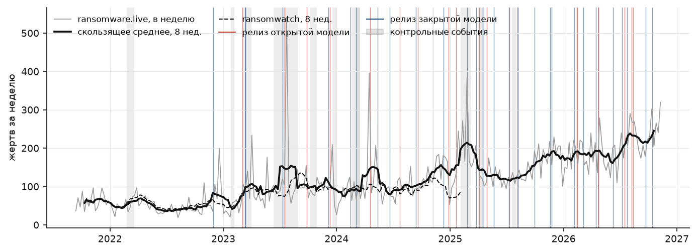
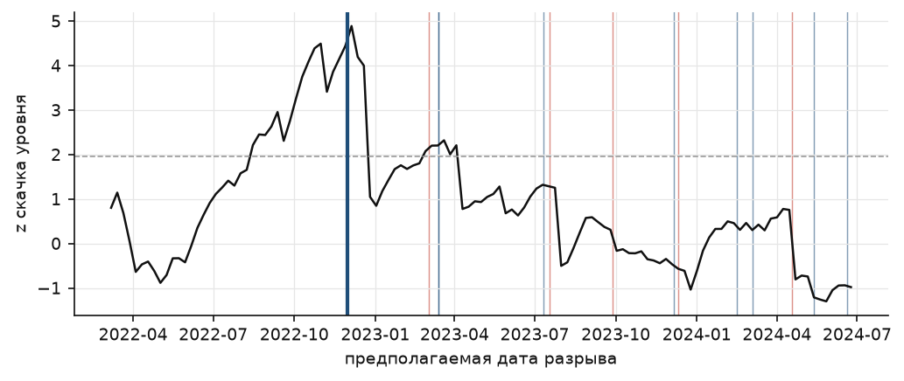

# Результаты на конец спринта 3

Данные: 270 недель (13.09.2021 — 09.11.2026), 31 994 жертвы на лик-сайтах шифровальщиков, 48 флагманских релизов (19 открытых, 29 закрытых), 900 CVE из KEV с известной датой публикации. Все цифры ниже — отклонение от базовой модели, в которой учтены тренд, сезонность, рождественская неделя и 12 контрольных событий.

## Коротко

**Статистически надёжной связи «вышел флагманский релиз → выросло число атак» на недельном горизонте нет.** Единственный устойчивый сигнал — рост числа постов на лик-сайтах в первые 3 недели после релиза. Однако в данных по дате атаки его нет, так что это эффект публикации, а не атак. Долгосрочный сдвиг уровня после ChatGPT действительно есть, но по данным его нельзя отделить от общего роста экосистемы шифровальщиков в 2023 году.

## H1. После крупных релизов растёт число атак

За 13 недель после релиза отклонение от базы составляет **+5,4 %**. Плацебо даёт p = 0,20: при случайном сдвиге календаря релизов такой же или больший эффект получается в каждом пятом случае. По 19 рядам (весь мир, 5 регионов, 12 отраслей, ряд по дате атаки) после поправки Бенджамини–Хохберга значимых эффектов нет: минимальное q = 0,47.

**Вывод: H1 не подтверждается.**

## H2. Эффект приходит с задержкой

| Окно после релиза | Посты на лик-сайтах | Плацебо p | По дате атаки (2023+) | Плацебо p |
|---|---|---|---|---|
| −4…−1 недели | +2,1 % | 0,65 | −0,1 % | 0,99 |
| 0…3 недели | **+13,1 %** | **0,04** | +1,7 % | 0,72 |
| 4…7 недель | −1,1 % | — | −0,3 % | 0,97 |
| 8…12 недель | +1,5 % | — | −0,2 % | 0,97 |

Сразу после релиза постов действительно больше. Но у лик-сайтов медианная задержка между атакой и постом составляет 1–7 дней, а у четверти постов — от 11 дней до месяца. Значит, атаки, о которых сообщают посты недель 0–3, в основном произошли **до** релиза. Если смотреть по дате атаки в том же окне 2023–2026 годов, эффекта нет: +1,7 %, p = 0,72. Отложенного эффекта через 4–12 недель, которого ждала H2, тоже нет.

Это та же ловушка, что и в прошлом проекте, только с другой стороны: сигнал оказывается свойством публикации, а не атаки. Скорее всего, релизы и пачки постов просто совпадают по календарю. Например, конец февраля — март плотно заполнен и релизами, и волнами Cl0p. Проверка по группам запланирована на спринт 4.

**Вывод: H2 не подтверждается.**

## H3. Открытые модели влияют сильнее закрытых

| Релизы | Событий | Недели 0–12 | Плацебо p |
|---|---|---|---|
| Открытые веса | 19 | −0,3 % | 0,96 |
| Закрытые (API) | 29 | +12,5 % | 0,07 |

Тест Вальда показывает разницу (p = 0,04), но направление обратное гипотезе. Плацебо эту разницу не подтверждает. Обычные HAC-ошибки дали бы для закрытых моделей p = 0,005, и это наглядный пример того, почему без плацебо в такой задаче нельзя. Интенсивность всех релизов языковых моделей из реестра Epoch тоже ничего не даёт: −5,0 % на релиз для открытых (ДИ −9,9…+0,2) и −10,6 % для закрытых (ДИ −20,7…+0,9).

**Вывод: H3 не подтверждается, данные скорее говорят об обратном, но и это незначимо.**

## H4. ИИ снижает порог входа, растёт доля технически сложных атак

- **Ряды KEV после релизов.** Новых эксплуатируемых CVE на 11,7 % больше (p = 0,08), CVE, используемых шифровальщиками, — на 28,4 % больше (p = 0,08). Это пограничный результат, который стоит перепроверить на дате эксплуатации, а не на дате внесения в каталог.
- **Время до эксплуатации не сократилось.** Медиана от публикации CVE до внесения в KEV до ChatGPT составляла 7 дней, после — 8 (p = 0,002). В 2025–2026 годах — 9 дней против 6 в 2022–2024 (p = 0,007). Доля CVE, попавших в KEV за неделю или быстрее, упала с 52–61 % в 2023 году до 42–53 % в 2026 году. Если бы ИИ ускорял написание эксплойтов, всё было бы наоборот. Оговорка: эта метрика зависит и от скорости работы самой CISA.
- **События наступательного ИИ** (WormGPT, FraudGPT, PromptLock, HexStrike, агенты) ни на одном ряду эффекта не дают: p ≥ 0,47.
- **Exploit-DB:** +39 % после релизов, p = 0,21. Ряд слишком шумный для выводов.

**Вывод: H4 не подтверждается.** Технический ряд KEV даёт пограничный сигнал, проверим его в спринте 4.

## H0. Всплески объясняются другими событиями

| Событие | Эффект | p |
|---|---|---|
| Cl0p: волна Cleo (2025) | +60 % | < 0,001 |
| Cl0p: волна MOVEit (2023) | +52 % | 0,06 |
| Ликвидация Hive | −42 % | 0,006 |
| Война в Израиле | −26 % | < 0,001 |
| Выборы в США 2024 | −21 % | < 0,001 |
| RansomHub уходит офлайн | −12 % | 0,09 |

Контрольные события снижают девианс модели на 10 % (с 4343 до 3925). Два крупнейших всплеска в ряду — это массовые эксплуатации Cl0p, к выходу моделей они отношения не имеют. Эффект рождественской недели незначим.

**Вывод: H0 подтверждается.**

## Долгосрочный сдвиг: ITS

| Разрыв | Источник | Скачок уровня | p | С поправкой на число активных групп | p |
|---|---|---|---|---|---|
| ChatGPT, 30.11.2022 | ransomware.live | +64 % | < 0,001 | +22 % | 0,10 |
| ChatGPT | ransomwatch | +58 % | < 0,001 | +43 % | < 0,001 |
| Утечка LLaMA, 03.03.2023 | ransomware.live | +47 % | 0,04 | +1 % | 0,97 |
| DeepSeek-R1, 20.01.2025 | ransomware.live | −7 % | 0,51 | +14 % | 0,09 |

Разрыв в дату ChatGPT воспроизводится на независимом краулере, и это самый сильный результат исследования. Но если перебрать все даты разрыва с марта 2022 по июнь 2024 года, дата ChatGPT окажется лишь третьей из 121, а z-статистика выше 1,5 держится на протяжении нескольких месяцев вокруг неё. Модель видит переход экосистемы на новый уровень на рубеже 2022–2023 годов: распад Conti, рост LockBit 3.0 и Cl0p. Приписать этот переход ChatGPT нельзя. Поиск точек перелома (PELT) нашёл 7 разрывов, 6 из них лежат в пределах ±4 недель от какого-нибудь релиза. Однако такие окна и так покрывают 71 % всех недель, поэтому совпадения не информативны.

## Структура атак

- **Отрасли, до и после ChatGPT:** доля технологий выросла на 2,6 п.п., профессиональных услуг — на 2,5 п.п., здравоохранения — на 2,2 п.п. Производство потеряло 3,6 п.п., ретейл — 2,9 п.п. (χ², p < 0,001).
- **2025–2026 против 2023–2024:** профессиональные услуги потеряли 8,3 п.п. Выросли доли ретейла (+3,9 п.п.), технологий (+3,2 п.п.) и производства (+2,8 п.п.).
- **Регионы, 2025–2026 против 2024:** доля Северной Америки снизилась на 4,8 п.п., выросли доли Азии и Океании (+2,4 п.п.), Европы (+1,7 п.п.) и Латинской Америки (+1,3 п.п.).

Сдвиги значимы, но к датам релизов они не привязаны. Это фон для сравнений, а не эффект LLM.

## Что это значит для ИБ-отделов

1. Планировать усиление мониторинга под даты релизов LLM нет оснований: на горизонте 1–3 месяцев всплеска атак после них не видно.
2. Реальные всплески создают массовые эксплуатации файлообменников (MOVEit, Cleo, GoAnywhere). Они дают +50–60 % к недельному числу жертв, и за ними стоит следить в первую очередь.
3. Данные лик-сайтов отстают от атак на дни и недели, поэтому строить на них оперативные сигналы нельзя: именно на этом сломался прошлый проект.

## Ограничения

- Лик-сайты показывают только тех жертв, кто не заплатил. Покрытие ransomware.live со временем растёт, и с трендом мы боремся сплайном и поправкой на число активных групп.
- Страна у записей 2021–2022 годов в основном неизвестна, поэтому региональные ряды считаются только с 2024 года.
- Если эффект LLM размазан по годам, событийный анализ его не поймает. Этот вопрос разбирает ITS, а он причинность не устанавливает.
- Начиная с 2025 года флагманские релизы выходят почти каждую неделю, и чистых контрольных окон без релизов почти не осталось.
