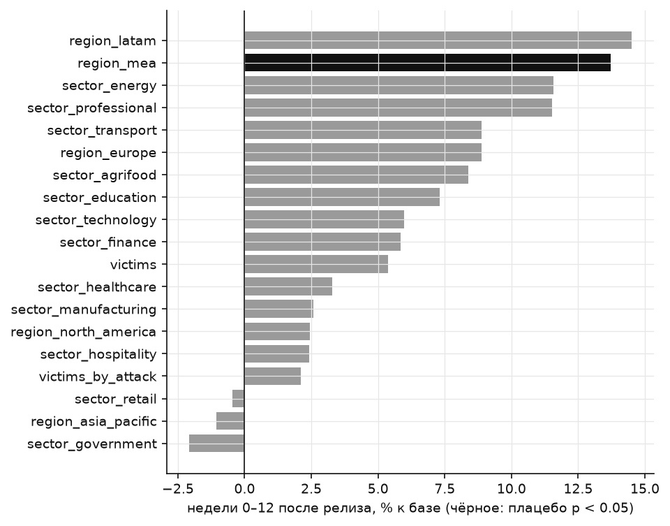
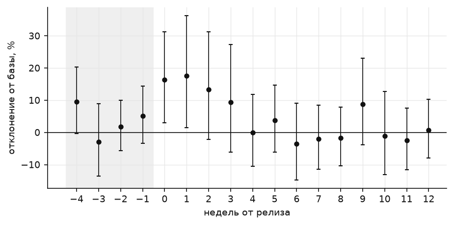
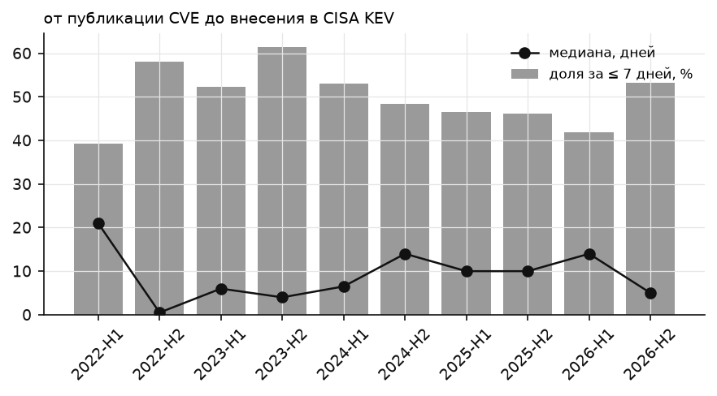
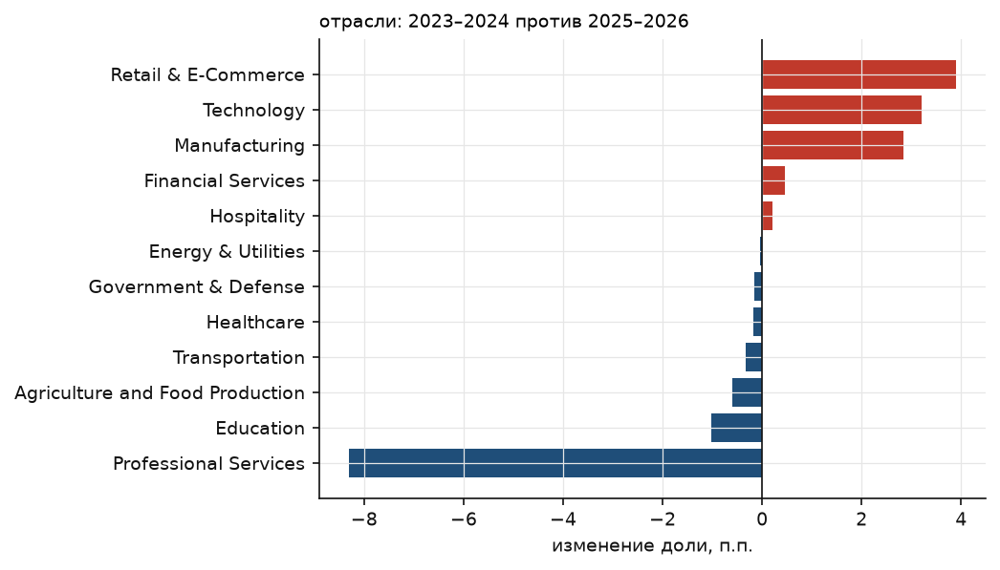

# Результаты на конец спринта 3

Взяли 270 недель, с 13.09.2021 по 09.11.2026. За это время на лик-сайтах шифровальщиков появилось 31 994 жертвы, вышло 48 крупных моделей (19 с открытыми весами и 29 только через API), а в KEV попало 900 CVE с известной датой публикации. Все проценты ниже показывают, насколько неделя отличается от того, что ждёт модель с учётом общего тренда, сезонности, рождественской недели и 12 посторонних событий вроде волны MOVEit.

## Коротко

Связи между выходом крупной модели и ростом атак в ближайшие недели мы не нашли. После релиза на лик-сайтах на три недели становится больше постов, но если считать по дате самой атаки, роста нет. В конце 2022 года число жертв действительно выросло, но в это же время рос весь рынок шифровальщиков, и отделить одно от другого по нашим данным нельзя.

## H1. После крупных релизов атак становится больше

За 13 недель после релиза жертв в среднем на 5,4 % больше ожидаемого. Чтобы проверить, не случайность ли это, мы 500 раз сдвигали все даты релизов в случайное место. Такой же или больший рост получался примерно в каждом пятом случае (p = 0,20), так что ничего особенного в настоящих датах нет.

Отдельно посчитали 19 рядов: весь мир, пять регионов, двенадцать отраслей и ряд по дате атаки. Когда проверяешь столько рядов сразу, какой-нибудь «эффект» найдётся случайно. С поправкой на это (метод Бенджамини–Хохберга) значимым не остался ни один, минимальное q = 0,47.

H1 не подтвердилась.

## H2. Эффект приходит с задержкой

| Недели после релиза | Посты на лик-сайтах | p (плацебо) | По дате атаки, 2023+ | p (плацебо) |
|---|---|---|---|---|
| за 4…1 до | +2,1 % | 0,65 | −0,1 % | 0,99 |
| 0…3 | **+13,1 %** | **0,04** | +1,7 % | 0,72 |
| 4…7 | −1,1 % | — | −0,3 % | 0,97 |
| 8…12 | +1,5 % | — | −0,2 % | 0,97 |

В первые три недели после релиза постов больше на 13 %. Но пост обычно выходит через несколько дней после атаки (медиана от 1 до 7 дней в разные годы), а четверть постов появляется через две недели и позже. Выходит, что большая часть атак из этих постов случилась ещё до релиза, и модель тут ни при чём. По дате атаки за те же годы роста нет: +1,7 %, p = 0,72. Роста через 4–12 недель, которого ждала H2, тоже нет.

На этом же мы попались в прошлом проекте: тогда сигнал из даркнета появлялся после атаки, теперь пост появляется после атаки. Похоже, что релизы и пачки постов просто чаще приходятся на одни и те же недели. Например, в конце февраля и в марте много и релизов, и волн Cl0p. В спринте 4 проверим это по отдельным группам.

H2 не подтвердилась.

## H3. Открытые модели влияют сильнее закрытых

| Релизы | Сколько | Недели 0…12 | p (плацебо) |
|---|---|---|---|
| Открытые веса | 19 | −0,3 % | 0,96 |
| Только API | 29 | +12,5 % | 0,07 |

Если что-то и видно, то наоборот: после закрытых моделей рост больше, чем после открытых. Тест Вальда показывает разницу (p = 0,04), а плацебо — нет. Обычные стандартные ошибки дали бы для закрытых моделей p = 0,005, поэтому без плацебо мы бы записали это в находки.

Мы также брали число всех языковых моделей, вышедших за неделю, по реестру Epoch. Связи нет и здесь: −5,0 % на каждый открытый релиз (95 % ДИ от −9,9 до +0,2) и −10,6 % на каждый закрытый (95 % ДИ от −20,7 до +0,9).

H3 не подтвердилась.

## H4. С ИИ растёт доля технически сложных атак

- После релизов в KEV попадает на 11,7 % больше новых CVE (p = 0,08), а CVE, которые использовали шифровальщики, на 28,4 % больше (p = 0,08). Это на грани значимости. Проверим по дате начала эксплуатации, а не по дате, когда CISA внесла CVE в каталог.
- Быстрее эксплуатировать уязвимости не стали. До ChatGPT от публикации CVE до попадания в KEV проходило в медиане 7 дней, после — 8 (p = 0,002). В 2025–2026 годах 9 дней против 6 в 2022–2024 (p = 0,007). За неделю или быстрее в каталог попадало 52–61 % CVE в 2023 году и 42–53 % в 2026-м. Правда, эти цифры зависят ещё и от того, как быстро работает сама CISA.
- После появления WormGPT, FraudGPT, PromptLock, HexStrike и ИИ-агентов ни один ряд не изменился, p везде не меньше 0,47.
- В Exploit-DB после релизов на 39 % больше эксплойтов, но p = 0,21. Эксплойты там выходят пачками, по этому ряду выводов не делаем.

H4 не подтвердилась. Ряд KEV ещё перепроверим в спринте 4.

## H0. Всплески объясняются другими событиями

| Событие | Изменение | p |
|---|---|---|
| Cl0p, волна Cleo (2025) | +60 % | < 0,001 |
| Cl0p, волна MOVEit (2023) | +52 % | 0,06 |
| Ликвидация Hive | −42 % | 0,006 |
| Война в Израиле | −26 % | < 0,001 |
| Выборы в США, 2024 | −21 % | < 0,001 |
| RansomHub уходит офлайн | −12 % | 0,09 |

С этими событиями модель описывает ряд на 10 % лучше (девианс падает с 4343 до 3925). Два самых больших всплеска за пять лет — это массовые взломы через уязвимости в MOVEit и Cleo, которыми воспользовалась группа Cl0p. К выходу моделей они отношения не имеют. Рождественская неделя заметно не отличается от обычных.

H0 подтвердилась.

## Рост в конце 2022 года

| Дата | Источник | Скачок | p | С учётом числа активных групп | p |
|---|---|---|---|---|---|
| ChatGPT, 30.11.2022 | ransomware.live | +64 % | < 0,001 | +22 % | 0,10 |
| ChatGPT | ransomwatch | +58 % | < 0,001 | +43 % | < 0,001 |
| Утечка LLaMA, 03.03.2023 | ransomware.live | +47 % | 0,04 | +1 % | 0,97 |
| DeepSeek-R1, 20.01.2025 | ransomware.live | −7 % | 0,51 | +14 % | 0,09 |

Здесь сравниваются уровень и тренд до даты и после неё (ITS). Скачок после выхода ChatGPT виден и в ransomware.live, и в ransomwatch, это самый сильный результат за спринт. Но мы прогнали тот же расчёт для каждой недели с марта 2022 по июнь 2024 года, и дата ChatGPT оказалась только третьей из 121. Похожий скачок дают и соседние месяцы. В это время распалась Conti, выросли LockBit 3.0 и Cl0p, и рынок шифровальщиков вышел на новый уровень. Списать это на ChatGPT нельзя.

Мы также искали в ряду точки перелома автоматически (алгоритм PELT). Он нашёл 7 таких точек, и 6 из них лежат в пределах четырёх недель от какого-нибудь релиза. Но релизы выходят так часто, что эти окна покрывают 71 % всех недель, так что совпадение ничего не значит.

## Как менялась структура атак

- До и после ChatGPT доля технологических компаний выросла на 2,6 п.п., профессиональных услуг — на 2,5 п.п., здравоохранения — на 2,2 п.п. Доля производства упала на 3,6 п.п., ретейла — на 2,9 п.п. (хи-квадрат, p < 0,001).
- В 2025–2026 годах по сравнению с 2023–2024 доля профессиональных услуг упала на 8,3 п.п. Выросли доли ретейла (+3,9 п.п.), технологий (+3,2 п.п.) и производства (+2,8 п.п.).
- В 2025–2026 годах по сравнению с 2024-м доля Северной Америки снизилась на 4,8 п.п. Выросли доли Азии и Океании (+2,4 п.п.), Европы (+1,7 п.п.) и Латинской Америки (+1,3 п.п.).

Сдвиги заметные, но с датами релизов они не совпадают.

## Что это значит для ИБ-отделов

1. Усиливать мониторинг к выходу новых моделей смысла нет: в ближайшие месяцы после релиза атак больше не становится.
2. Следить стоит за массовыми взломами файлообменников вроде MOVEit, Cleo и GoAnywhere. После них жертв за неделю становится на 50–60 % больше.
3. Лик-сайты сообщают об атаках с опозданием на дни и недели, поэтому для быстрого реагирования они не годятся.

## Ограничения

- На лик-сайты попадают только те, кто не заплатил выкуп. К тому же ransomware.live со временем следит за всё большим числом групп. Это мы учитываем через тренд и число активных групп.
- Для записей 2021–2022 годов страна почти никогда не указана, поэтому регионы считаем только с 2024 года.
- Если LLM влияют на атаки медленно, за годы, наш анализ по неделям это не поймает. Остаётся сравнение уровней до и после, а оно не доказывает, что причина именно в модели.
- С 2025 года крупные модели выходят почти каждую неделю, так что недель без релизов поблизости для сравнения почти не осталось.
